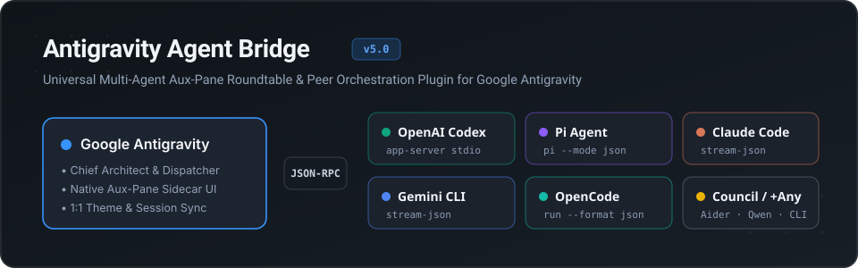
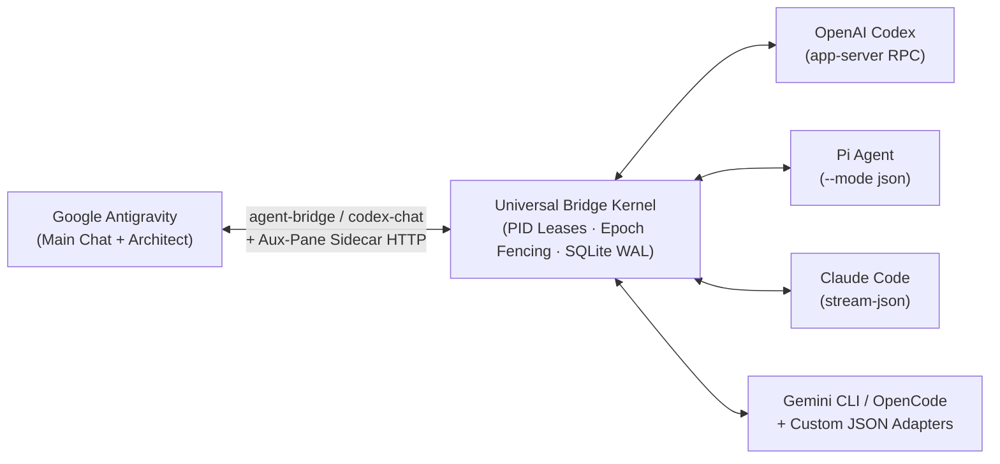

<div align="center">



<br/>

**English** | [简体中文](./README.zh-CN.md)

[](https://github.com/ZJUSCODE/antigravity-agent-bridge/actions/workflows/ci.yml)
[](https://nodejs.org/)
[](#)
[](#)
[](./LICENSE)
[](https://linux.do/)

**Turn Google Antigravity into a Multi-Agent Command Center & Peer-Review Roundtable.**
Connect **OpenAI Codex**, **Pi Coding Agent**, **Anthropic Claude Code**, **Google Gemini CLI**, **OpenCode**, and **any custom CLI coding agent** inside Antigravity's native right-hand Auxiliary Pane — with **0 external npm dependencies**.

</div>

---

## Why `antigravity-agent-bridge`?

Talking directly to GPT / Codex with rough, conversational prompts often feels clunky — whereas brainstorming naturally with **Gemini inside Google Antigravity**, letting Gemini synthesize a rigorous, context-complete engineering prompt, and then handing that spec to **OpenAI Codex** (or **Claude Code** / **Pi**) to execute produces dramatically better results. Previously, doing this meant manually copy-pasting prompts and `git diff`s across multiple windows.

**`antigravity-agent-bridge`** automates this exact workflow natively inside **Google Antigravity**:

- **Native Aux-Pane Roundtable UI**: Embeds directly into Antigravity's right-hand Sidecar pane, binding live to Antigravity's `:root` theme CSS variables (`Light`, `Dark`, and custom themes update in the exact same frame with zero visual seam) and following your active Antigravity conversation **1:1**.
- **5 Built-In Streaming Agent Drivers + Extensible Custom Adapters**:
  | Agent | CLI Binary | Streaming Protocol | Stateful Session Resume | Read-Only / Write Sandboxing |
  | :--- | :--- | :--- | :--- | :--- |
  | **OpenAI Codex** | `codex` | Persistent `app-server --stdio` JSON-RPC v2 | `thread/resume` + safe `thread/fork` | `--sandbox` + live approval cards |
  | **Pi Agent** | `pi` | `pi --mode json -p` NDJSON | `--session-id <uuid>` | `--tools read,grep,find,ls` vs full |
  | **Claude Code** | `claude` | `claude -p --output-format stream-json` | `--resume <session_id>` | `--permission-mode plan` vs `acceptEdits` |
  | **Gemini CLI** | `gemini` | `gemini -p --output-format stream-json` | `--resume <session_id>` | Read-only vs `--yolo` |
  | **OpenCode** | `opencode` | `opencode run --format json` | `-s <session_id>` | Scoped workspace execution |
  | **Custom CLI** | *Any CLI* | Declarative `agents.custom.json` | Optional template | Custom args (`Aider`, `Qwen`, `Goose`…) |
- **Parallel Multi-Agent Council ("群策圆桌")**: Broadcast one architectural RFC or uncommitted `git diff` to **all installed agents in parallel** (`--agent council` or `--agents codex,pi,claude`), watching each agent stream its independent verdict into the same room.
- **Adaptive Convergence-Driven Rounds (`1..N`)**: No rigid "2-round" or "3-round" limits — Antigravity autonomously governs the number of discussion or review-fix-verify rounds based on task complexity and peer convergence signals (`[PEER_STATUS: CONVERGED | NEEDS_ROUND]`, `[PEER_VERDICT: PASS | CHANGES_REQUIRED]`), stopping in 1 round when aligned or iterating 4+ rounds until every `P0/P1` issue is resolved.
- **Architect → Executor Dispatch**: Tell Antigravity in plain language: *"Design the plan yourself, dispatch implementation & tests to Codex / Pi / Claude, and iterate review-and-fix rounds until the diff passes."*
- **Bidirectional Peer Skills**: Installs `agent-bridge` & `codex-chat` into Antigravity **and** automatically installs the reverse `antigravity-chat` skill into `~/.codex/skills/`, `~/.pi/agent/skills/`, and `~/.claude/skills/` so external agents can consult local Antigravity (`agy`) too — guarded by `AGY_CODEX_PEER_CALL=1` hardware-level anti-recursion locks.

---

## 30-Second Quickstart (Windows / macOS / Linux / WSL 2)

**Prerequisites**:
- **Node.js `>= 22.5.0`** (uses built-in `node:sqlite` — zero C++ native compilation or `npm install` bloat!)
- [Google Antigravity](https://antigravity.google) + **at least one** coding agent CLI (`codex`, `pi`, `claude`, `gemini`, or `opencode`).

### macOS / Linux / WSL 2
```bash
git clone https://github.com/ZJUSCODE/antigravity-agent-bridge.git "$HOME/.gemini/config/plugins/codex-bridge"
cd "$HOME/.gemini/config/plugins/codex-bridge"
npm run setup
npm run doctor
```

### Windows (PowerShell)
```powershell
git clone https://github.com/ZJUSCODE/antigravity-agent-bridge.git "$HOME\.gemini\config\plugins\codex-bridge"
cd "$HOME\.gemini\config\plugins\codex-bridge"
npm run setup
npm run doctor
```

Then simply talk to Antigravity in plain language:
- *"Open the Aux-Pane Roundtable and debate our database sharding design with **Codex** until you both converge on the schema."*
- *"Design the API contract yourself, dispatch implementation and unit tests to **Pi** (or **Claude Code**), and iterate until your diff review passes."*
- *"Run a parallel **Council** code review (`Codex + Pi + Claude`) on my uncommitted Git changes."*

---

## Architecture Overview



### Adding Any Custom CLI Agent in 10 Lines (`agents.custom.json`)

Copy [`agents.example.json`](./agents.example.json) to `agents.custom.json` inside the plugin root to register **Aider**, **Qwen Code**, **Goose**, **Cursor Agent**, or internal enterprise tools — they immediately light up in both the Sidecar UI picker and `talk_agent.mjs`!

---

## CLI Usage & Diagnostics

```bash
# Inspect all detected coding agents, models, and health checks:
npm run doctor

# Run the 17 automated concurrency, path-sandbox, NDJSON streaming & HTTP long-polling tests:
npm test

# Cleanly remove reverse peer skills from ~/.codex, ~/.pi, and ~/.claude:
npm run uninstall-bridge
```

---

## Community, Contributing & License

- **Community Acknowledgment**: Proudly shared with and supported by the **[LINUX DO](https://linux.do/)** developer community.
- **Contributing**: Contributions, new agent adapters, and issue reports are warmly welcome! See [CONTRIBUTING.md](./CONTRIBUTING.md).
- **License**: Released under the [MIT License](./LICENSE).
