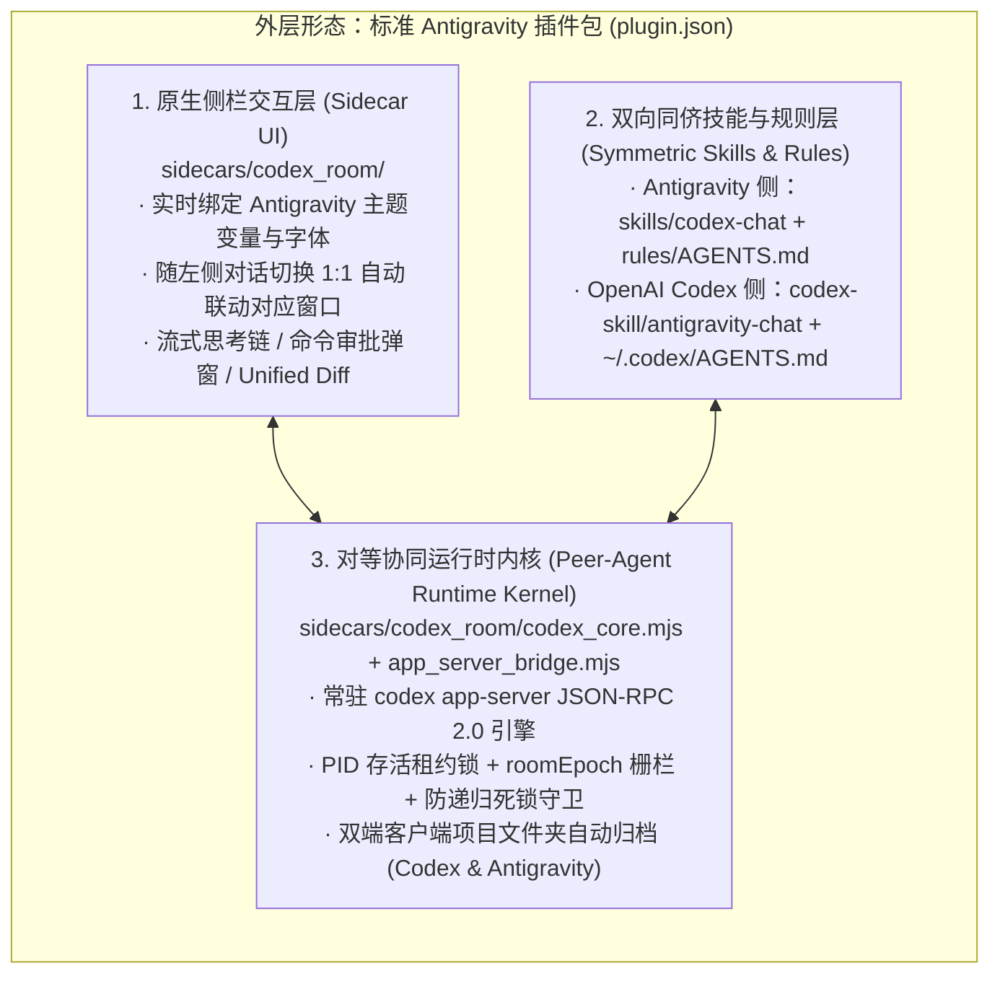

# Codex Bridge (`codex-bridge` v4.0)

[](https://github.com/ZJUSCODE/codex-bridge/actions/workflows/ci.yml)
[](https://nodejs.org/)
[](#)
[](./LICENSE)

**`codex-bridge`** 是一套面向 **Google Antigravity** 与 **OpenAI Codex** 的**零外部依赖、跨平台全栈多智能体插件与对等协同架构（Full-Stack Plugin + Native Sidecar UI + Symmetric Peer-Agent Kernel）**。

无需安装第三方 `npm` 依赖，安装后即可在 Antigravity 右侧辅助栏（Auxiliary Side Pane）直接获得**与 Antigravity 原生界面及亮/暗主题 100% 实时融合**的「Codex 对讲室」，并打通 **Antigravity ↔ Codex 双向有状态协商、主从派工执行、对抗式代码互审与双端项目文件夹同步归档**。

---

## 一、项目架构定位（它是 Skill、插件还是 Agent 架构？）

它是一个以 **标准 Antigravity 插件包（Plugin Bundle）** 为交付外壳、内部融合了 **三层能力** 的完整双智能体协同系统：



---

## 二、核心特性

1. **100% 原生 Antigravity 视觉风格与实时主题同步**
   - 直接绑定 `sidecar_sdk/preload.js` 注入 `:root` 的宿主实时 CSS 变量（`--background`、`--foreground`、`--card`、`--border`、`--primary`、`--font-family`、`--editor-font-family`）与 `MutationObserver` 同步监听。切换 Antigravity 任意亮色 / 暗色 / 自定义主题时，对讲室**同帧无感变色，零色差接缝、零突兀感**。
2. **随 Antigravity 对话 1:1 自动切换窗口**
   - 在左侧切换任意 Antigravity 会话（含新建会话及项目文件夹下的 `[双AI]` 归档会话），右侧对讲室自动切换到对应的讨论窗口；后台其他会话正在讨论时仅以顶部轻量状态条提示，绝不串台或覆盖映射。
3. **三种协作范式开箱即用**
   - **对等方案碰撞（RFC / Debug）**：双 AI 围绕架构选型或疑难 Bug 自动多轮推演、互相证伪并收敛结论（`[PEER_STATUS: CONVERGED]`）。
   - **主从决策 → 落地执行（Architect → Executor）**：Antigravity 负责需求拆解与架构拍板，通过 `--sandbox workspace-write`（或面板权限控制）直接驱动 Codex 落盘写码、跑单测，再由 Antigravity 核验 `git diff` 验收。
   - **洁净室对抗式代码互审（Adversarial Code Review）**：自动采集工作区 `git diff HEAD` 与带行号源码快照，按 `P0–P3` 缺陷等级交叉审查并精确到 `文件:行号`。
4. **双端项目文件夹同步可见**
   - 通过 `codex app-server` 原生 RPC（`project/list`、`project/create`、`thread/metadata/update`、`thread/name/set`）与 Antigravity 官方 `agentapi`，双 AI 讨论会自动归档至 **OpenAI Codex 桌面端** 与 **Google Antigravity 左侧栏** 对应的项目文件夹下（前缀 `[双AI]`）。
5. **高适配性与企业级并发安全**
   - **全平台开箱即用**：原生支持 **Windows（含 Store MSIX 自动更新 `EBUSY` 退避重试）**、**macOS** 与 **Linux / WSL 2**。
   - **零硬编码模型自适应**：自动按 `CODEX_DEFAULT_MODEL` → `~/.codex/config.toml` → `~/.codex/models_cache.json` → `auto` 顺序匹配当前账号可用模型，任何 ChatGPT Plus / Pro / Team / Enterprise 账号克隆即用。
   - **零依赖安全内核**：基于 Node.js 内置 `node:sqlite` 只读索引 WAL 历史会话并在续聊时自动执行 `thread/fork`（彻底规避与 Codex 桌面端争抢写锁）；内置 `AGY_CODEX_PEER_CALL=1` 硬件级防递归死循环锁与逐跳符号链接防目录穿越校验。

---

## 三、30 秒快速安装（Windows / macOS / Linux）

**环境要求**：
- Node.js **`>= 22.5.0`**（使用内置 `node:sqlite` 与原生测试运行器，无需编译任何 C++ 原生模块）
- 已安装 [Google Antigravity](https://antigravity.google) 与 [OpenAI Codex](https://openai.com/codex)（桌面端或 CLI）

### 方式 A：直接克隆至 Antigravity 插件目录（推荐）

**macOS / Linux / WSL 2 (Bash / Zsh)**：
```bash
git clone https://github.com/ZJUSCODE/codex-bridge.git "$HOME/.gemini/config/plugins/codex-bridge"
cd "$HOME/.gemini/config/plugins/codex-bridge"
npm run setup
npm run doctor
```

**Windows (PowerShell)**：
```powershell
git clone https://github.com/ZJUSCODE/codex-bridge.git "$HOME\.gemini\config\plugins\codex-bridge"
cd "$HOME\.gemini\config\plugins\codex-bridge"
npm run setup
npm run doctor
```

### 方式 B：克隆至任意工作目录后一键同步安装

```bash
git clone https://github.com/ZJUSCODE/codex-bridge.git
cd codex-bridge
npm run setup    # 自动同步插件至 ~/.gemini/config/plugins/codex-bridge 并配置 ~/.codex/skills/antigravity-chat
npm run doctor   # 一键巡检本地双端可执行文件、模型配置与连接健康度
```

安装完成后，在 Antigravity 对话框直接对 AI 说：
- *“打开 Codex 对讲室，和 Codex 讨论两轮当前项目的重构方案”*
- *“你先定接口方案，定好后直接让 Codex 去把代码和单测写完，你审查通过再交付给我”*
- *“让 Codex 对当前未提交的 Git 改动做一轮严格 Code Review”*

或在 OpenAI Codex 中直接说：
- *“用 `$antigravity-chat` 找本地 Antigravity 交叉审查一下当前改动”*

---

## 四、可选环境变量配置

所有路径与模型均支持零配置自动探测，也可通过环境变量按需覆盖：

| 环境变量 | 作用说明 | 默认行为 |
| :--- | :--- | :--- |
| `CODEX_BIN` | 指定 `codex` 可执行文件绝对路径 | 自动探测 WindowsApps / `/Applications/Codex.app` / `PATH` |
| `AGY_BIN` | 指定 Antigravity CLI (`agy`) 路径 | 自动探测系统安装目录与 `PATH` |
| `CODEX_DEFAULT_MODEL` | 覆盖新建房间的默认模型 | 自动读取 `~/.codex/config.toml` 或 `models_cache.json` 首选模型 |
| `CODEX_HOME` | 自定义 Codex 配置与会话目录 | `~/.codex` |
| `CODEX_BRIDGE_EXPORT_DIR` | 自定义一键导出 Markdown 的目录 | 自动选择本地常用导出目录或 `~/Downloads/Codex-Room` |
| `CODEX_BRIDGE_PROJECT_DIRS` | 额外扫描的项目根目录列表（`:` 或 `;` 分隔） | 自动聚合当前工作区、Codex 项目、Antigravity 项目与 `~/Projects` |

---

## 五、目录结构

```text
codex-bridge/
├── plugin.json                              # Antigravity 标准插件清单
├── package.json                             # 零外部依赖工程配置与脚本入口
├── assets/logo.svg                          # 插件矢量图标
├── rules/AGENTS.md                          # Antigravity 侧自动协商与防递归规则
├── sidecars/codex_room/                     # 右侧辅助栏原生 Sidecar 服务与前端
│   ├── sidecar.json                         # AUX_PANE 视图声明
│   ├── main.mjs                             # HTTP API、鉴权、长轮询与双端文件夹同步守护
│   ├── app_server_bridge.mjs                # 常驻 codex app-server --stdio JSON-RPC 桥
│   ├── codex_core.mjs                       # 跨进程互斥锁、SQLite WAL 索引与双端执行内核
│   ├── index.html / styles.css / app.js     # 原生 Antigravity 风格界面与实时主题跟随
├── skills/codex-chat/                       # Antigravity -> Codex 同侪技能与 CLI (talk_codex.mjs)
├── codex-skill/antigravity-chat/            # Codex -> Antigravity 同侪技能与 CLI (talk_antigravity.mjs)
├── scripts/
│   ├── install.mjs                          # 跨平台幂等安装器 (npm run setup)
│   ├── uninstall.mjs                        # 安全卸载清理脚本 (npm run uninstall-bridge)
│   └── doctor.mjs                           # 环境自检诊断工具 (npm run doctor)
└── tests/                                   # 15 项并发锁、安全沙盒、模型自适应与 HTTP 端到端测试
```

---

## 六、开发验证与安全卸载

```bash
# 语法静态检查 + 运行全部自动化测试套件：
npm run check
npm test

# 清理安装到 ~/.codex 下的同侪技能与规则块（不影响任何历史对话记录）：
npm run uninstall-bridge
```

## License

Released under the [MIT License](./LICENSE).
