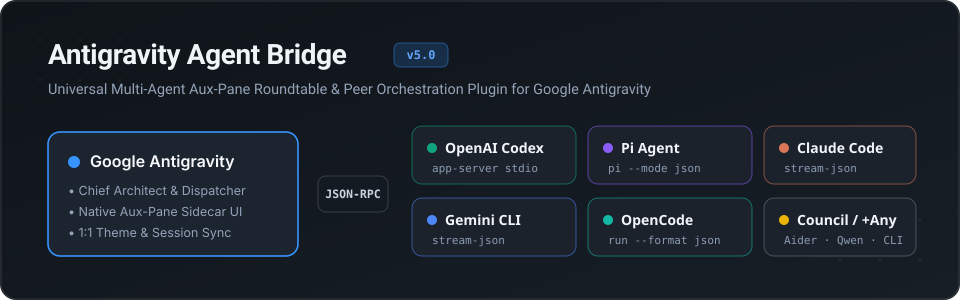

<div align="center">



<br/>

[English](./README.md) | **简体中文**

[](https://github.com/ZJUSCODE/antigravity-agent-bridge/actions/workflows/ci.yml)
[](https://nodejs.org/)
[](#)
[](#)
[](./LICENSE)

**把 Google Antigravity 升级为「多智能体协同指挥中心与同屏圆桌对讲室」。**
零第三方 `npm` 依赖，在 Antigravity 右侧原生辅助栏一键连接 **OpenAI Codex**、**Pi Agent**、**Anthropic Claude Code**、**Google Gemini CLI**、**OpenCode** 及任意自定义 CLI 智能体！

</div>

---

## 一、为什么需要 `antigravity-agent-bridge`？

在真实研发中，不同智能体各有所长：你可能希望由 **Antigravity** 统筹需求与架构决策，指派 **OpenAI Codex** 攻坚后端核心算法、**Pi** 或 **Claude Code** 编写前端与单测，或者让它们对同一份 `git diff` **并行开展对抗式交叉 Code Review**——而不是自己在四五个终端窗口之间来回复制粘贴。

**`antigravity-agent-bridge`（v5.0）** 在 Antigravity 内部原生打通了这一闭环：

1. **100% 原生 Antigravity 界面风格与实时主题同步**
   - 直接绑定 Antigravity 宿主实时注入 `:root` 的主题变量（`--background`、`--foreground`、`--card`、`--border`、`--primary`、`--font-family`），`MutationObserver` 同帧响应亮色 / 暗色 / 自定义主题切换，零色差接缝；随左侧 Antigravity 会话切换 **1:1 自动联动对应窗口**。
2. **五大主流 Coding Agent 原生流式驱动 + 零代码自定义扩展**
   | 智能体 | 可执行命令 | 流式通信协议 | 有状态多轮会话保持 | 只读审查 / 落盘改码沙盒 |
   | :--- | :--- | :--- | :--- | :--- |
   | **OpenAI Codex** | `codex` | 常驻 `app-server --stdio` JSON-RPC v2 | `thread/resume` + 安全 `thread/fork` | `--sandbox` + 面板实时命令审批卡 |
   | **Pi Agent** | `pi` | `pi --mode json -p` 实时事件流 | `--session-id <uuid>` | `--tools read,grep,find,ls` / 完整写工具 |
   | **Claude Code** | `claude` | `claude -p --output-format stream-json` | `--resume <session_id>` | `--permission-mode plan` / `acceptEdits` |
   | **Gemini CLI** | `gemini` | `gemini -p --output-format stream-json` | `--resume <session_id>` | 只读模式 / `--yolo` 自动执行 |
   | **OpenCode** | `opencode` | `opencode run --format json` | `-s <session_id>` | 工作区受控执行 |
   | **自定义 CLI** | *任意命令* | 声明式 `agents.custom.json` | 模板变量注入 | 10 行 JSON 接入 `Aider`、`Qwen`、`Goose` 等 |
3. **「群策圆桌（Council）」多智能体并行会诊**
   - 在面板底部切换至 **「圆桌群聊 (Council)」** 或通过 `--agents codex,pi,claude` 发起调用，即可将架构方案或未提交的 Git 改动**同时并发派给本机所有已就绪智能体**，同屏对比多方独立审计结论。
4. **三种工程协作模式大白话直达**
   - **你提需求 → Antigravity 决策 → 派发任意 Agent 落地执行 → Antigravity 独立验收 Diff**
   - **双 / 多 AI 多轮架构方案碰撞（RFC / Debug）**
   - **洁净室对抗式代码互审（Review `P0–P3` 分级定位 `文件:行号`）**
5. **双向对等互调与防死循环安全内核**
   - 安装时自动为本机已安装的 **Codex**（`~/.codex/skills/`）、**Pi**（`~/.pi/agent/skills/`）与 **Claude Code**（`~/.claude/skills/`）挂载反向呼叫 Antigravity 的同侪技能，内置 `AGY_CODEX_PEER_CALL=1` 硬件级防递归死锁锁与跨进程 PID 租约锁。

---

## 二、30 秒快速安装（Windows / macOS / Linux / WSL 2）

**前置条件**：
- Node.js **`>= 22.5.0`**（直接复用内置 `node:sqlite`，零 C++ 编译依赖、无需漫长 `npm install`）
- 已安装 [Google Antigravity](https://antigravity.google) 及上述**任意一款或多款**本地 Agent CLI（装了哪几款，面板里就会自动点亮哪几款 `已就绪` 标签）。

### macOS / Linux / WSL 2
```bash
git clone https://github.com/ZJUSCODE/antigravity-agent-bridge.git "$HOME/.gemini/config/plugins/codex-bridge"
cd "$HOME/.gemini/config/plugins/codex-bridge"
npm run setup
npm run doctor
```

### Windows (PowerShell)
```powershell
git clone https://github.com/ZJUSCODE/antigravity-agent-bridge.git "$HOME\.gemini\config\plugins\codex-bridge"
cd "$HOME\.gemini\config\plugins\codex-bridge"
npm run setup
npm run doctor
```

装好后，直接在 Antigravity 对话框用大白话吩咐即可：
- *“打开右侧对讲室，和 **Codex**（或 **Pi** / **Claude Code**）讨论两轮这个模块的架构方案”*
- *“你先定好接口规范，然后直接派 **Pi** 写前端、派 **Codex** 写后端单测，你审查通过再交付给我”*
- *“开一轮 **圆桌群聊（Council）**，让本机所有 Agent 并行审查一下我当前的 Git 未提交改动”*

---

## 三、接入更多自定义 Agent（`agents.custom.json`）

将仓库根目录的 [`agents.example.json`](./agents.example.json) 复制为 `agents.custom.json`，只需 10 行 JSON 即可把 **Aider**、**Qwen Code**、**Goose**、**Kimi CLI** 或团队内部自研 CLI Agent 接入右侧面板与调度脚本！

---

## 四、一键自检、自动化测试与干净卸载

```bash
npm run doctor            # 一键巡检本机已安装的各家 Agent CLI 路径与连接状态
npm test                  # 运行 16 项并发锁、路径防穿越、多协议流式解析与 HTTP 长轮询测试
npm run uninstall-bridge  # 干净移除安装到 ~/.codex、~/.pi、~/.claude 下的同侪技能（保留一切历史对话）
```

## 开源协议

本项目基于 [MIT License](./LICENSE) 开源，欢迎 Star、Fork 与提交新智能体适配器 PR！
